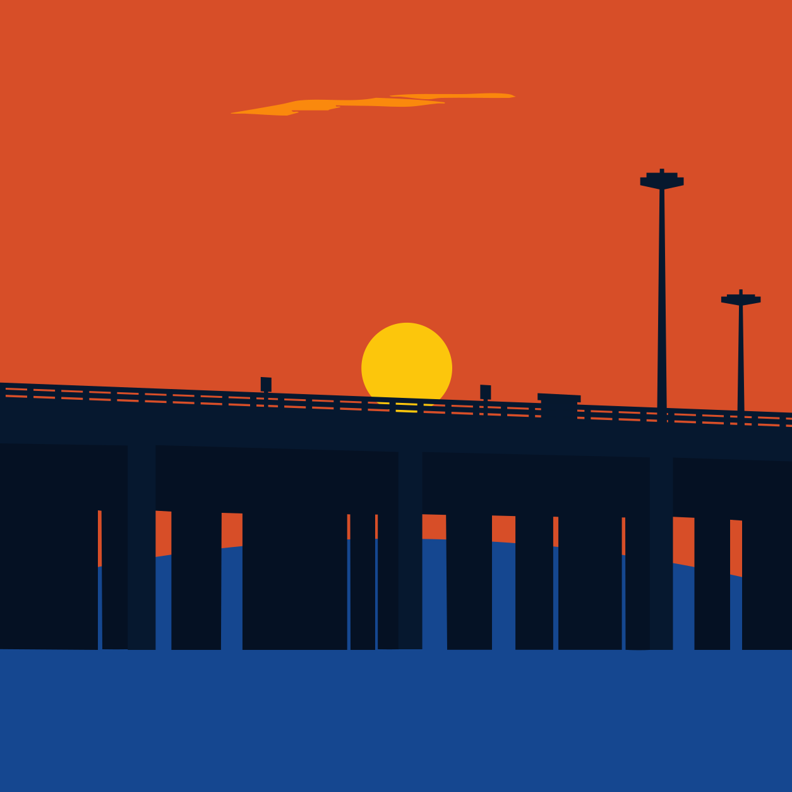
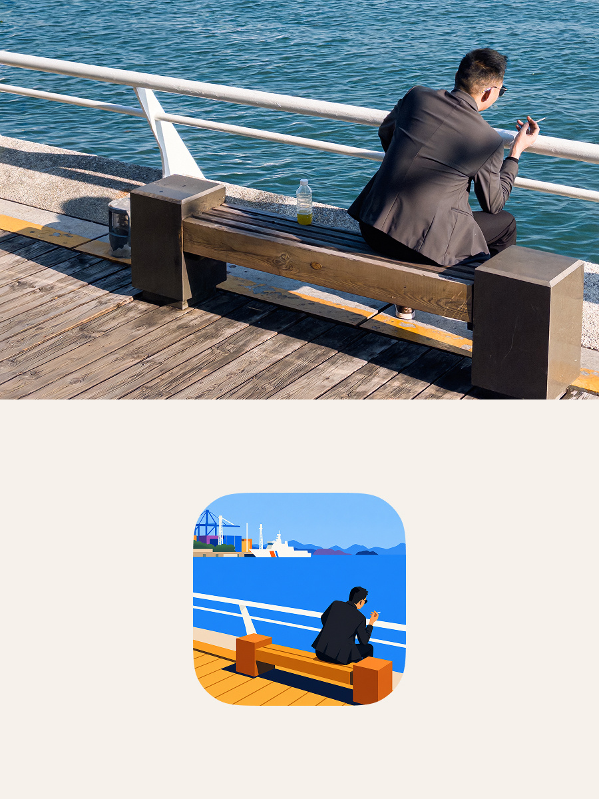
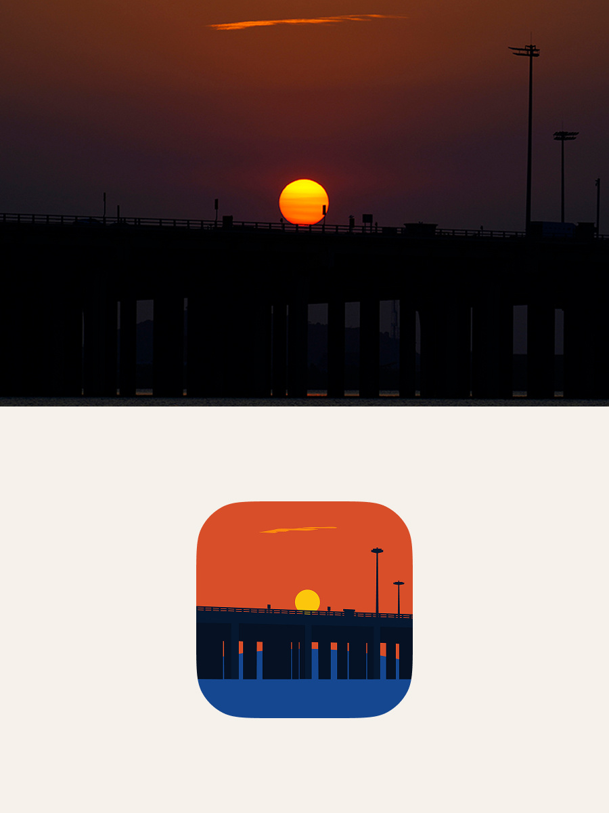

# DnR FlatPic v2.0 — Photo-to-Flat Illustration Agent Skill



DnR FlatPic v2.0 is an open-source Agent Skill for ChatGPT, Codex, Claude Code, and other Agent Skills-compatible AI agents. It transforms photographs and visually dense images into sparse, recognizable, high-saturation flat-vector-style illustrations through semantic compression instead of literal tracing, while preserving composition and identity anchors. Final images use fixed-HSB solid fills with crisp boundaries and no gradients, glow, blur, or photographic surface texture.

**Keywords:** photo-to-flat illustration, photo-to-vector illustration, image abstraction, iconification, semantic compression, flat illustration, flat-vector art, ChatGPT Skill, Codex Skill, Agent Skill, 照片转扁平插画。

**Source:** <https://github.com/CreateLafont/dnr-flat-pic>

**Release identity:** `DnR FlatPic v2.0` / `$dnr-flat-pic`

**One-command installation:**

```bash
npx skills add CreateLafont/dnr-flat-pic
```

**Ask your coding agent to install it:**

```text
Install the Agent Skill from https://github.com/CreateLafont/dnr-flat-pic
```

中文：

```text
请从下面的 GitHub 仓库安装这个 Agent Skill：https://github.com/CreateLafont/dnr-flat-pic
```

**Download the latest upload bundle:** [skill.zip](https://github.com/CreateLafont/dnr-flat-pic/releases/latest/download/skill.zip)

Example semantic requests:

- `Turn this photo into a high-saturation flat-vector-style illustration with no gradients.`
- `把这张照片转换成无渐变的高饱和扁平插画。`

## Highlights

- Semantic compression instead of literal tracing.
- One primary semantic system with a controlled supporting hierarchy.
- Fixed HSB palette with role-based color assignment rather than source-hue matching.
- Solid flat fills, crisp boundaries, and hard-edged discrete light and shadow.
- Dedicated handling for aspect-ratio changes, revisions, source cleanup, and retry control.
- Base output remains a raster PNG.
- After a successful base output, optional poster composition, square SVG icon generation, and native-ratio SVG export are available as explicit derived actions.

## Showcase

The following boards are manually composed presentation mockups. They combine source photographs with selected DnR FlatPic illustrations and are not raw, unedited skill outputs.

<table>
  <tr>
    <td></td>
    <td></td>
  </tr>
</table>

## Installation

For cross-agent installation, use:

```bash
npx skills add CreateLafont/dnr-flat-pic
```

For a direct ChatGPT or Codex upload, download [`skill.zip`](https://github.com/CreateLafont/dnr-flat-pic/releases/latest/download/skill.zip) from GitHub Releases and upload it through the product's Skills interface. The bundle keeps `SKILL.md` at the archive root.

For manual Codex installation, clone or download this repository directly into the Codex skills directory so the final path is:

```text
$CODEX_HOME/skills/dnr-flat-pic/SKILL.md
```

On a default Windows installation, the path is commonly:

```text
C:\Users\<username>\.codex\skills\dnr-flat-pic\SKILL.md
```

Restart or refresh Codex after installation if the skill does not appear immediately.

This v2.0 release uses the existing `dnr-flat-pic` Skill identity and replaces the earlier version at that path.

## Usage

Attach a source photograph and invoke:

```text
$dnr-flat-pic
```

Example request:

```text
Use DnR FlatPic v2 to reconstruct this photograph as a clean flat illustration.
Preserve the original composition and aspect ratio.
```

After the accepted illustration is delivered, request one explicit action:

```text
生成海报
生成 SVG 图标
导出当前插画 SVG（原比例）
都要
```

The installed skill reads base rendering rules from the bundled core references. Poster, square-source, and SVG details are loaded only for the selected derived action. Derived actions require a user-installed Node.js LTS; the Skill never installs Node.

## Color System

The authoritative HSB values, tolerances, and role-assignment rules live exclusively in [`references/generation-spec.md`](references/generation-spec.md). Other files reference palette roles without redefining their numeric values.

## Repository Structure

```text
SKILL.md                         v2.0 Skill entry point and workflow
agents/openai.yaml               Codex UI metadata
assets/icon.svg                  Codex UI icon
references/generation-spec.md    Flat rendering, HSB palette, and cleanup rules
references/semantic-complexity.md
references/aspect-ratio-adaptation.md
references/examples-and-failures.md
references/square-source.md      Conditional square-source workflow
references/poster-output.md      Conditional poster workflow
references/svg-output.md         Conditional SVG workflows
assets/poster-layout.json        Figma-derived fixed poster geometry
assets/ios-continuous-rounded-square.svg
runtime/                         Bundled pure WASM/JS dependencies, no Node binary
scripts/                         Deterministic derived-output scripts
docs/showcase/                   Two manually composed documentation mockups
docs/support/                    Optional Alipay and WeChat tip codes
scripts/package-skill.ps1       Reproducibly builds the uploadable skill.zip
```

## Known Limitations

- Image generation is model-dependent and may vary between runs.
- Prompt constraints improve palette and flat-color consistency but are not pixel-level rendering guarantees.
- The base output is a raster illustration; SVGs are deterministic VTracer traces of accepted PNGs, not semantic hand-authored vectors.
- Poster and SVG derived actions require a user-installed Node.js LTS and local command/file execution. The Skill does not download or install Node.
- Source text, logos, and interface elements may require revision when a model retains them.

## Feedback

Open a GitHub issue for reproducible problems or general improvements. Do not submit third-party style-reference images or example photographs without clear redistribution rights.

## Voluntary Support

DnR FlatPic is free and open source. Optional Alipay and WeChat tips are described in [`SUPPORT.md`](SUPPORT.md). Tipping does not unlock features, services, support priority, or additional rights.

## License

[MIT](LICENSE)
